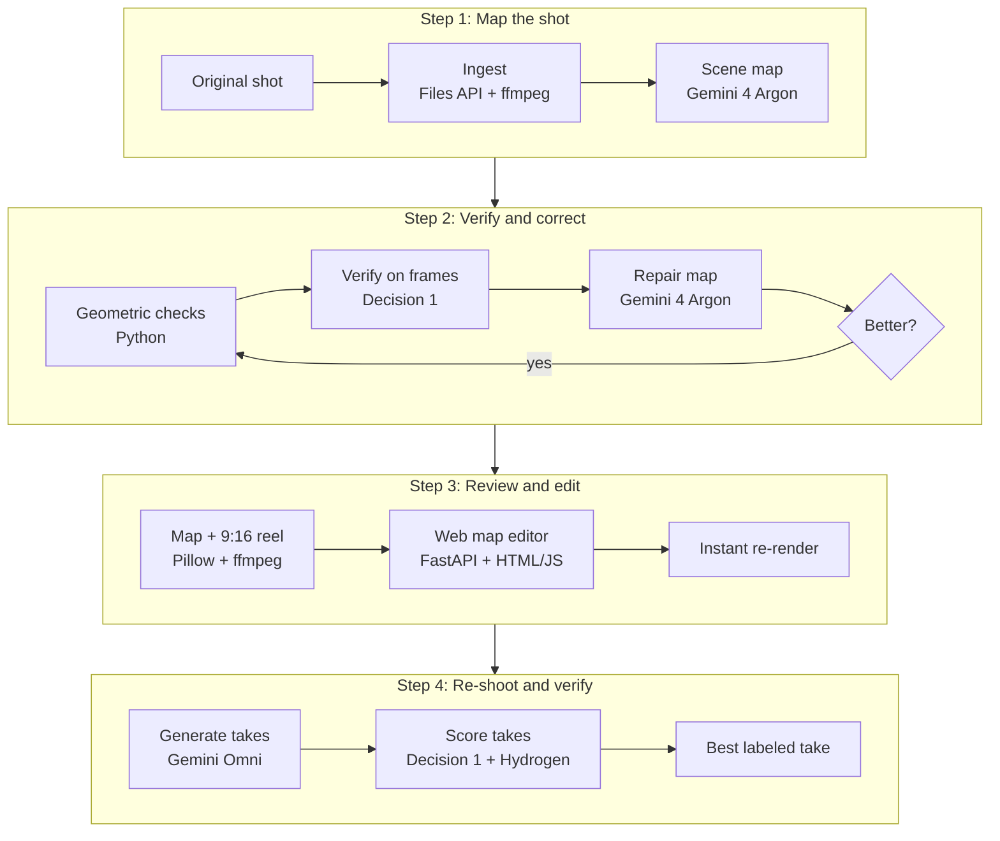
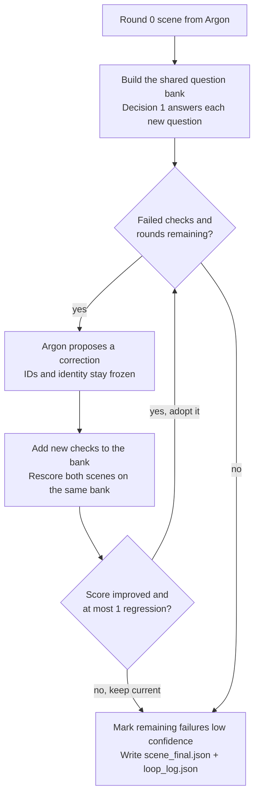
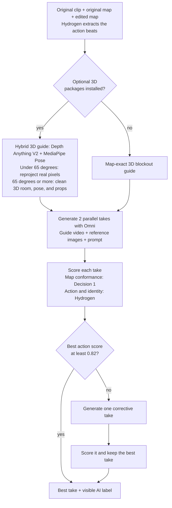
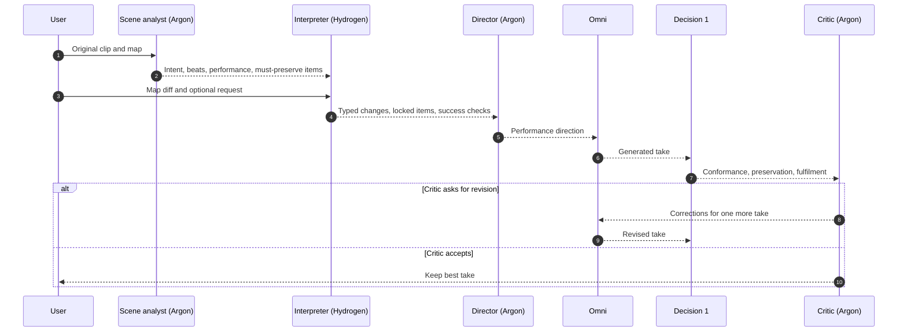
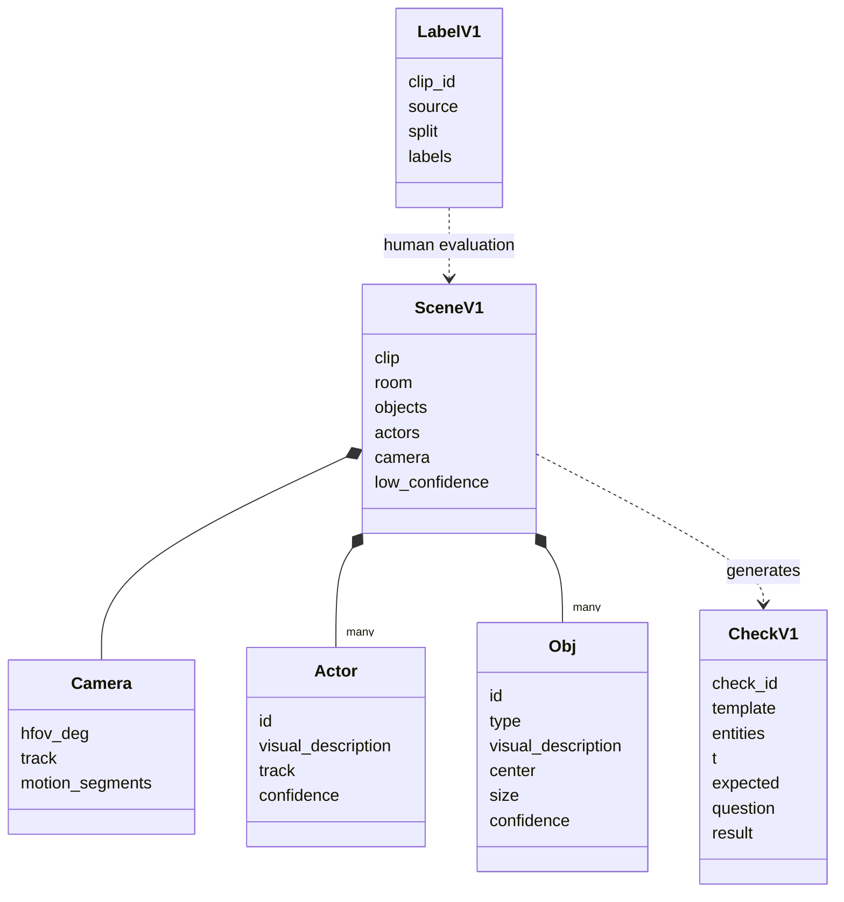

# God-Shot

**Turn one continuous film shot into a verified overhead blocking map, edit the map, and re-shoot the scene from a new angle.**

Built at the Gemini 4 NYC Hackathon (Cerebral Valley x Google DeepMind), Nov 21, 2026. Track: **Element 119**.

## What it does

1. **Upload one continuous shot.** God-Shot is designed for 5 to 15 second clips with no cuts.
2. **Map the scene.** Gemini 4 Argon watches the video and writes a structured overhead map of the room, objects, actors, and camera path.
3. **Test the map.** Our geometry code turns the map into yes/no predictions, such as "the door is in the left half of the frame at 0:03."
4. **Verify against real frames.** Gemini Decision 1 returns a probability for each prediction.
5. **Correct what failed.** Argon repairs the map for up to 3 rounds. A correction is kept only if it scores better on a shared question bank.
6. **Show the result.** The app renders an animated map and a 9:16 reel. Elements it still does not trust are visibly marked as low confidence.
7. **Direct a new shot.** Drag the camera, draw a path, orbit an actor, choose a POV, or type an instruction.
8. **Re-shoot and check it.** Gemini Omni generates labeled AI takes, and God-Shot scores them against the edited map and the original action.

## System overview



### Which model does what

| Model | Job |
|---|---|
| **Gemini 4 Argon** | Watches the video, writes the scene map, repairs failed elements, analyzes the scene, directs performances, critiques takes |
| **Gemini 4 Hydrogen** | Turns text into map edits, interprets change requests, extracts action beats, analyzes new views, compares action frame by frame |
| **Gemini Decision 1** | Returns probabilities for map checks, re-shoot conformance, preservation, and requested changes |
| **Gemini Omni 1.2 Flash** | Generates the re-shoot from the guide video, reference images, and directed prompt |

Model IDs are configured in one place: [`godshot/config.py`](godshot/config.py).

## The verification loop

The checks are generated by code, not by a language model. They cover visibility, left/right position, relative order, distance, approach, pan, and dolly.



An uncertain answer counts as a miss, so a candidate cannot improve its score by making the verifier abstain. The verifier guides the loop, but it is **not** the final accuracy grader. Headline accuracy must come from human labels.

## Map editing

The browser editor changes the same `scene.v1` map that the pipeline verified.

- **Camera:** drag keyframes, set yaw and field of view, draw a path, or use smooth curves.
- **Shot presets:** static, dolly, truck, pan, and arc.
- **POV board:** over-the-shoulder, reverse 180, side profile, wide, close-up, and 360 orbit.
- **Actors:** hold a position across the whole shot or animate it at the current time.
- **Text edits:** Hydrogen translates an instruction into validated map operations.
- **Review:** undo/redo, keyframe tracks, and synced Before/After playback.

## The re-shoot pipeline

This diagram shows the web app flow.



Important details:

- **The web app** generates 2 takes at 360p, runs action verification, and can add one corrective take. Its ranking score is `0.55 x conformance + 0.45 x action`.
- **The CLI** uses the blockout guide by default. Pass `--mode reproject` to use the 3D guide.
- **Failed Omni calls** retry once with a compact prompt, fewer reference images, and 360p output.
- **Long shots** are sped up to fit Omni's 15 second output limit instead of losing the ending.
- **Audio** from the original clip is carried into the 3D guide video.
- **Every generated video** receives a visible "AI-generated re-shoot" label.

### Direct agents (CLI option)

`--direct` adds a small agent team that directs performance and requested changes. It does not change the camera path or map positions.



## Scene contract

Every stage shares versioned Pydantic contracts in [`godshot/schema.py`](godshot/schema.py).



## Quick start

Requires Python 3.11, ffmpeg, and a Gemini API key.

```bash
git clone https://github.com/rishika1099/God-Shot.git
cd God-Shot
python3.11 -m venv .venv
source .venv/bin/activate
pip install -r requirements.txt
cp .env.example .env
```

Add `GEMINI_API_KEY` to `.env`, then install ffmpeg (`brew install ffmpeg` on macOS or `apt install ffmpeg` on Debian/Ubuntu).

To enable 3D reprojection, install the optional packages:

```bash
pip install -r requirements-3d.txt
```

Without them, re-shoots automatically use the map-exact blockout guide.

### Run the app

```bash
python -m godshot web
```

Open <http://127.0.0.1:8000>, upload a shot, edit the map, and re-shoot it.

Try the UI with mock data and no API calls:

```bash
python -m godshot web --mock
```

Serve existing runs in read-only cached mode:

```bash
GODSHOT_OFFLINE=1 python -m godshot web
```

### Command line

```bash
python -m godshot smoke
```

```bash
python -m godshot baseline clips/shot.mp4 -o out/shot
```

Run the full loop and render the reel:

```bash
python -m godshot run clips/shot.mp4 -o out/shot
```

Re-shoot from a map saved by the editor:

```bash
python -m godshot reshoot clips/shot.mp4 --orig out/shot/scene_final.json --edited out/shot/scene_edit_1.json -o out/shot/reshoot --n 2 --mode reproject
```

Add directing agents and a free-text request:

```bash
python -m godshot reshoot clips/shot.mp4 --orig out/shot/scene_final.json --edited out/shot/scene_edit_1.json -o out/shot/directed --n 2 --direct --critic 1 --request "make the actor limp"
```

Score any video against a map:

```bash
python -m godshot conformance path/to/video.mp4 --edited out/shot/scene_edit_1.json
```

### Output files

| File | Contents |
|---|---|
| `scene_r{n}.json` | Scene map for round 0 and each accepted correction |
| `checks_r{n}.json` | Checks and verifier answers for those rounds |
| `scene_final.json` | Final accepted map with low-confidence marks |
| `scene_edit_{n}.json` | Maps saved from the editor |
| `loop_log.json` | Scores, regressions, changes, tokens, and latency |
| `map.mp4`, `reel.mp4` | Animated map and 9:16 reel |
| `reshoot_takes/take_{n}.mp4` | Individual generated takes |
| `reshoot_best.mp4`, `reshoot_best.json` | Best take and its scores |

## Evaluation

God-Shot's evaluation is designed to compare the one-call Argon baseline with the corrected map on held-out clips, using **human labels only**.

| Item | Current state on `main` |
|---|---|
| Dataset manifest | 51 clips: 40 CameraBench, 10 *Tears of Steel*, 1 *Sintel* |
| Labels | 40 CameraBench test clips with mapped expert camera-motion labels. The 11 Blender clips still need human labels |
| Scoring code | `eval/run_all.py` and `eval/score.py` |
| Results and figures | Not published yet |

Run and summarize the labeled test split (this makes paid API calls):

```bash
python -m godshot eval --split test --system baseline
```

```bash
python -m godshot eval --split test --system full
```

```bash
python eval/score.py summary --split test
```

We do not publish an accuracy claim until these runs finish on the frozen test split.

## Project structure

```text
godshot/
  __main__.py    CLI
  config.py      Environment and model IDs
  schema.py      Shared contracts
  cache.py       Disk cache for API responses
  ingest.py      Upload and frame extraction
  extract.py     Argon scene extraction
  geometry.py    Projection and scene math
  checks.py      Geometric check generation
  verify.py      Decisions API verifier
  correct.py     Argon correction
  pipeline.py    Verify-and-correct loop
  render.py      Animated overhead map
  compose.py     9:16 reel and comparison video
  edit.py        Map edits and text instructions
  reshoot.py     Omni generation and scoring
  reproject.py   Depth, pose, and novel-view guide
  direct.py      Analyst, director, and critic agents
  web/           FastAPI app and browser UI
eval/            Clips manifest, labels, and evaluation
tests/           Unit and integration tests
.claude/specs/   Feature specs and status board
```

## Development

```bash
ruff check .
```

```bash
pytest
```

Work is organized as specs in [`.claude/specs/`](.claude/specs/). Use a branch named `<owner>/<spec>-<slug>` and open a PR. `main` changes only through group-approved PRs. See [CLAUDE.md](CLAUDE.md#git-workflow-own-branches-group-approved-prs).

| Owner | Area | Specs |
|---|---|---|
| **Prajesh** | Foundation, ingest, Omni re-shoot | S00, S01, S12 |
| **Siva** | Geometry, Decisions verifier, web UI, scoring | S03, S05, S09, S11 |
| **Akash** | Extraction, renderer, reel, Direct agents | S02, S07, S08, S14 |
| **Rishika** | Checks, correction loop, eval data, charts, pitch | S04, S06, S10, S13 |

## Data and licenses

- Evaluation clips come from CameraBench (CC BY 4.0), *Tears of Steel* (CC BY 3.0), and *Sintel* (CC BY 3.0).
- Credits and modifications are listed in [`eval/CREDITS.md`](eval/CREDITS.md).
- No copyrighted film footage is allowed in the dataset or demo.
- Generated re-shoots are labeled as AI-generated.

## Team

Rishika, Prajesh, Akash, Siva
